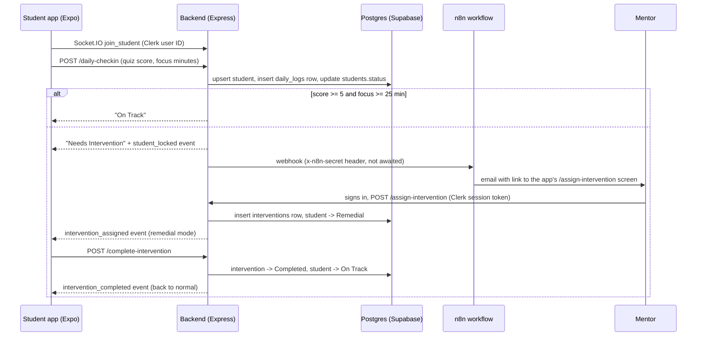

# Alcovia Intervention Engine (prototype)

A prototype "closed loop" for student focus sessions, built for an Alcovia engineering assignment. A student runs a timed focus session in the app; if they fail the daily check-in (low quiz score or too little focus time) or leave the app mid-session, the backend logs the attempt and triggers an n8n workflow that emails a mentor. The mentor assigns a remedial task, and the student's app switches into remedial mode.

> **Status:** prototype. The full loop (focus session → check-in → mentor email → mentor assigns a task → student remedial mode → student completes → back on track) is implemented end to end. See [Limitations](#limitations-and-next-steps) for what is still rough.

## How it works



Students are created automatically the first time a signed-in user joins or checks in: the backend maps the Clerk user ID to a `students` row through `students.clerk_user_id`. Endpoints accept either that row's UUID or the Clerk user ID as `student_id`.

### Auth

| Endpoint | Who calls it | Auth |
|---|---|---|
| `POST /daily-checkin` | Student app | none |
| `POST /assign-intervention` | Mentor (app), or n8n / scripts | `Authorization: Bearer <Clerk session token>` **or** `x-n8n-secret: $N8N_SECRET` |
| `POST /complete-intervention` | Student or mentor (app) | same as above |
| `GET /api/interventions?mentor_email=` | Mentor task list (app) | same as above |

The app gets the token from Clerk's `getToken()`; the backend verifies it with `CLERK_SECRET_KEY`. For local testing without Clerk, `ALLOW_DEV_AUTH_BYPASS=true` (ignored when `NODE_ENV=production`) lets unauthenticated requests through.

### Real-time events (Socket.IO, same port as the API)

| Client emits | Room joined |
|---|---|
| `join_student {student_id}` | `student:<uuid>`; the server immediately re-sends the current state (`intervention_assigned` or `student_locked`) so a reload or reconnect lands in the right mode |
| `join_mentor {mentor_email}` | `mentor:<email>` |

Server events: `student_locked`, `intervention_assigned` (the intervention row: `id`, `task`, `attempt_id`, `student_id`, `status`, `mentor_id`), `intervention_completed` (to the student) and `intervention_updated` (to the mentor).

## What's in the repo

| Part | Path | What it does |
|---|---|---|
| Student / mentor app | `alcovia-app/` | Expo (React Native + web) with expo-router and Clerk sign-in. Focus timer, quiz input, "cheater check" that reports a failed session when the app goes to the background, mentor dashboard, and a screen to assign an intervention. |
| Backend | `backend/server.js` | Express + `pg` + Socket.IO. Check-in, assign, complete and list endpoints, student state updates and real-time events. Input validation lives in `backend/utils/validate.js`. |
| Database | `backend/sql/schema.sql` | `students`, `daily_logs` and `interventions` tables with indexes. Idempotent, so it doubles as the migration. |
| Automation | `N8N JSON/Mentor-Dispatch.json` | Exported n8n workflow: receives the webhook and emails the mentor a link to the app's assignment screen. |

## Tech stack

Expo / React Native Web, TypeScript, expo-router, Clerk, Socket.IO client · Node.js, Express, PostgreSQL (`pg`), Supabase · n8n Cloud

## Running locally

### Prerequisites

- Node.js 18+
- A PostgreSQL database (a Supabase project works)
- An n8n instance (n8n Cloud or self-hosted) and a Clerk application

### Backend

```bash
cd backend
npm install
cp .env.example .env     # see the comments in .env.example
psql "$DATABASE_URL" -f sql/schema.sql
npm start                # API + Socket.IO on http://localhost:3000
```

`sql/schema.sql` is safe to re-run. Run it again on an existing database to add the `students.clerk_user_id` column.

Backend environment variables (all documented in `backend/.env.example`):

| Variable | Required | Purpose |
|---|---|---|
| `DATABASE_URL` | yes | Postgres connection string |
| `PORT` | no (3000) | API and Socket.IO port |
| `CLERK_SECRET_KEY` | yes, for the app | Verifies the app's Clerk session tokens |
| `CLERK_JWT_KEY` | no | Clerk JWT public key for networkless verification |
| `N8N_WEBHOOK_URL` | no | Mentor-Dispatch webhook; when unset, failures are logged and the student is locked but no email is sent |
| `N8N_SECRET` | no | Sent to n8n, and accepted in `x-n8n-secret` on protected endpoints |
| `MENTOR_EMAIL` | no | Mentor address sent to n8n when the check-in has none |
| `APP_URL` | no | Public app URL sent to n8n for the email link |
| `FRONTEND_ORIGIN` | no | Comma-separated CORS origins; any origin when unset |
| `ALLOW_DEV_AUTH_BYPASS` | no | `true` skips auth outside production |

From the repo root, `npm run backend` and `npm run app` start each part (after installing dependencies in each folder).

### App

```bash
cd alcovia-app
npm install
# create alcovia-app/.env with:
#   EXPO_PUBLIC_CLERK_PUBLISHABLE_KEY=pk_test_...
#   EXPO_PUBLIC_CLERK_SIGNIN_URL=...        (the app shows a setup screen without it)
#   EXPO_PUBLIC_BACKEND_URL=http://localhost:3000
#   EXPO_PUBLIC_SOCKET_URL=http://localhost:3000   (optional, defaults to the backend URL)
#   EXPO_PUBLIC_SUPABASE_URL=...  EXPO_PUBLIC_SUPABASE_ANON_KEY=...   (dashboard and tasks screens)
npx expo start --web
```

### n8n

1. Import `N8N JSON/Mentor-Dispatch.json`.
2. In **Send email**, select your own SMTP credential and set the sender address (`fromEmail`).
3. The email goes to the `mentor_email` the backend sends (`MENTOR_EMAIL`, or `mentor@local.test` if neither is set).
4. The link points to `<APP_URL>/assign-intervention?student_id=…&attempt_id=…&mentor_email=…`. Set `APP_URL` in the backend `.env`, or replace the `https://YOUR-APP-URL` fallback in **Edit Fields**.
5. Activate the workflow and put its production webhook URL in `N8N_WEBHOOK_URL`.

The mentor opens the link, signs in with Clerk using the address the email was sent to, types any task and submits. The app sends that request with the mentor's Clerk session token, so n8n doesn't need to call the backend itself.

## Limitations and next steps

- **No mentor role:** any signed-in Clerk user can assign or complete interventions; mentors and students aren't distinguished, and a student isn't limited to their own record. The assign screen only warns when the signed-in email differs from the one in the link.
- **Unauthenticated parts:** `/daily-checkin` and the Socket.IO `join_student` / `join_mentor` events don't check who is calling. A client can join any mentor's room.
- **The n8n webhook doesn't check `x-n8n-secret`**. Turn on Header Auth on the Webhook node if the URL could leak.
- **Sign-in is web-only:** the app uses Clerk's hosted sign-in page (`EXPO_PUBLIC_CLERK_SIGNIN_URL`), so native builds have no in-app Clerk sign-in yet.
- **Stale lockfiles:** `backend/package-lock.json` and `backend/pnpm-lock.yaml` still list the dependencies removed with the old backend. Run `npm install` to refresh them.
- No automated tests.
