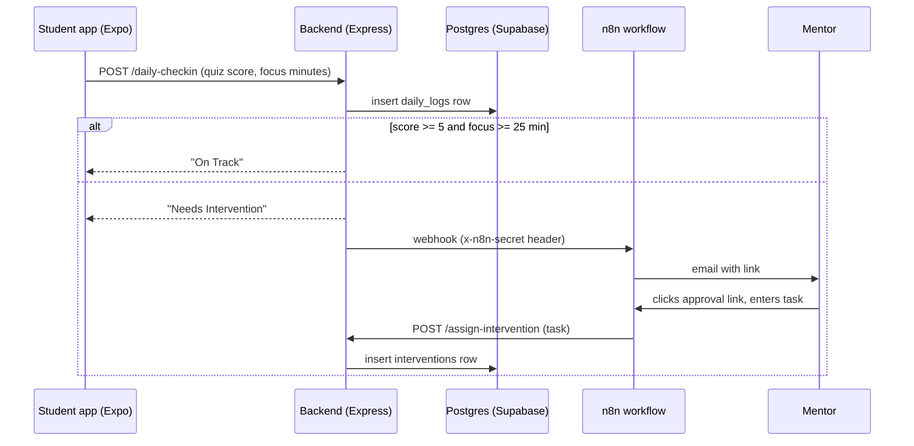

# Alcovia Intervention Engine (prototype)

A prototype "closed loop" for student focus sessions, built for an Alcovia engineering assignment. A student runs a timed focus session in the app; if they fail the daily check-in (low quiz score or too little focus time) or leave the app mid-session, the backend logs the attempt and triggers an n8n workflow that emails a mentor. The mentor assigns a remedial task, and the student's app switches into remedial mode.

> **Status:** prototype. The Expo app and the n8n workflow are built out; the backend currently implements the check-in and assignment endpoints but not yet the real-time (Socket.IO) events or the `/complete-intervention` endpoint the app expects. See [Limitations](#limitations-and-next-steps).

## How it works



## What's in the repo

| Part | Path | What it does |
|---|---|---|
| Student / mentor app | `alcovia-app/` | Expo (React Native + web) with expo-router and Clerk sign-in. Focus timer, quiz input, "cheater check" that reports a failed session when the app goes to the background, mentor dashboard, and a screen to assign an intervention. |
| Backend | `backend/server.js` | Express + `pg`. `POST /daily-checkin` applies the pass/fail rule, stores the log and calls the n8n webhook on failure. `POST /assign-intervention` stores the mentor's task. |
| Database | `backend/sql/schema.sql` | `students`, `daily_logs` and `interventions` tables with indexes. |
| Automation | `N8N JSON/Mentor-Dispatch.json` | Exported n8n workflow: receives the webhook, emails the mentor, waits for approval, then calls the backend. |

`backend/src/index.js` and `backend/routes/auth.js` are an earlier Supabase-client version of the backend with its own JWT login, kept for reference; `server.js` is the entry point used by `npm start`.

## Tech stack

Expo / React Native Web, TypeScript, expo-router, Clerk, Socket.IO client · Node.js, Express, PostgreSQL (`pg`), Supabase · n8n Cloud

## Running locally

### Prerequisites

- Node.js 20.19+ or 22.7+ (`server.js` uses ES module imports without `"type": "module"`; older versions fail on `npm start`)
- A PostgreSQL database (a Supabase project works)
- An n8n instance (n8n Cloud or self-hosted) and a Clerk application

### Backend

```bash
cd backend
npm install
cp .env.example .env     # fill in DATABASE_URL, N8N_WEBHOOK_URL, N8N_SECRET, etc.
psql "$DATABASE_URL" -f sql/schema.sql
npm start                # http://localhost:3000
```

### App

```bash
cd alcovia-app
npm install
# create alcovia-app/.env with:
#   EXPO_PUBLIC_CLERK_PUBLISHABLE_KEY=pk_test_...
#   EXPO_PUBLIC_CLERK_SIGNIN_URL=...        (the app shows a setup screen without it)
#   EXPO_PUBLIC_BACKEND_URL=http://localhost:3000
#   EXPO_PUBLIC_SOCKET_URL=http://localhost:3000
#   EXPO_PUBLIC_SUPABASE_URL=...  EXPO_PUBLIC_SUPABASE_ANON_KEY=...   (dashboard and tasks screens)
npx expo start --web
```

### n8n

Import `N8N JSON/Mentor-Dispatch.json` into n8n, then replace the placeholders `REPLACE_WITH_YOUR_N8N_SECRET` and `https://YOUR-BACKEND-URL` with your own values (the secret must match `N8N_SECRET` in the backend `.env`).

## Limitations and next steps

- **Real-time events:** the app listens for `student_locked`, `intervention_assigned` and `intervention_completed` over Socket.IO, but `server.js` does not run a Socket.IO server yet.
- **Missing endpoints:** the app calls `POST /complete-intervention` and `GET /api/interventions`, which the backend does not implement yet.
- **State updates:** the backend records logs and interventions but doesn't update `students.status`.
- **Security:** `/assign-intervention` doesn't verify the caller (mentor auth or the n8n secret), and CORS allows any origin.
- **Two backend versions** (`server.js`, `src/index.js`) should be merged into one.
- **ID mismatch:** the app sends the Clerk user ID as `student_id`, but `daily_logs.student_id` is a UUID foreign key to `students`, so check-ins from real signed-in users fail until students are mapped to Clerk IDs.
- No automated tests.
